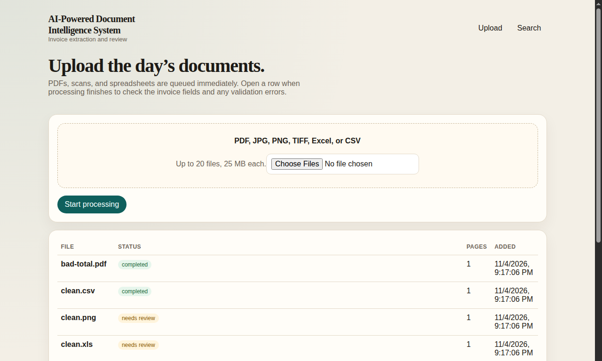
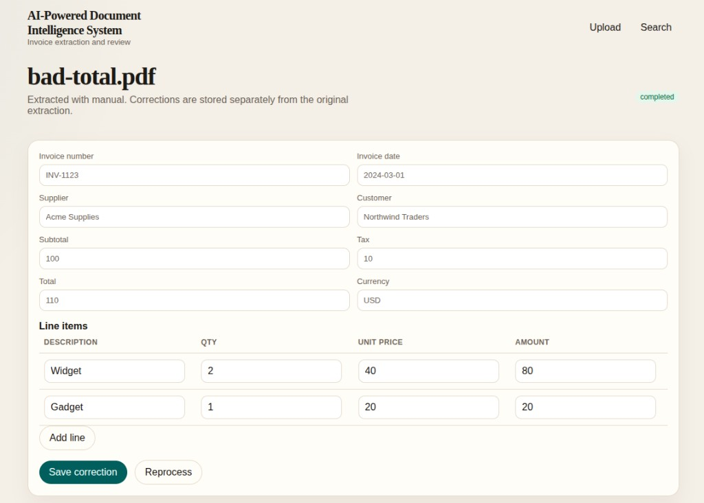
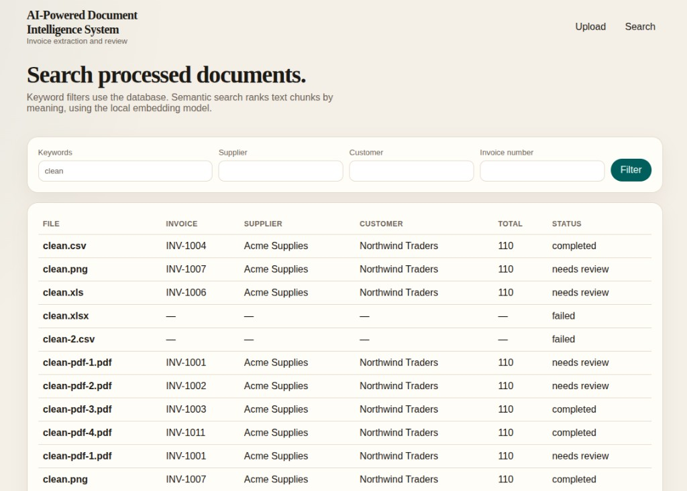

# AI-Powered Document Intelligence System

The system reads invoices from PDF, images, and spreadsheets. An LLM extracts the invoice fields. Validation checks the numbers, then a reviewer can correct the result and search past documents.

Extracted fields: invoice number, date, supplier, customer, subtotal, tax, total, currency, and line items. If a value is not in the document, it stays empty.

## Demo

Upload a batch. Each file is queued, then the list shows status.



Open a document to check the extracted fields. Save correction stores your edit and runs the checks again.



Search by keyword, supplier, customer, or invoice number.



## LLM

Extraction calls the Gemini API. Set this in `.env` before you start the app:

```bash
EXTRACTION_PROVIDER=gemini
GEMINI_API_KEY=your-api-key
GEMINI_MODEL=gemini-3.5-flash-lite
```

Get an API key from [Google AI Studio](https://aistudio.google.com/apikey). The prompt sent to the model is in `services/docproc/app/prompt.py`.

After you change `.env`, restart the document service so it loads the new key.

## Run with Docker

Requirements: Docker and Docker Compose.

```bash
cp .env.example .env
```

Add the LLM settings above to `.env`, then:

```bash
docker compose up --build -d
```

Open http://localhost:3000. The API is http://localhost:3001.

Postgres for this project is on port 5434. Redis is on port 6379. OCR tools are inside the document image.

```bash
docker compose down
```

`docker compose down -v` also deletes the database, uploaded files, and the cached embedding model.

## Run without Docker

Requirements: Node.js 20, Python 3.12+, Tesseract, Poppler, and Docker for Postgres and Redis.

```bash
cp .env.example .env
```

Set the LLM variables in `.env`. `DATABASE_URL` should use `localhost:5434`, `REDIS_URL` should be `redis://localhost:6379`, and `DOCPROC_URL` should be `http://127.0.0.1:8000`. Set `STORAGE_DIR` to the full path of `storage/uploads` on your machine.

```bash
docker compose up -d postgres redis
ln -sf ../../.env apps/api/.env
npm install
npm run prisma:push
python3 -m venv services/docproc/.venv
services/docproc/.venv/bin/pip install -r services/docproc/requirements.txt
mkdir -p storage/uploads
```

Run these in three terminals:

```bash
npm run dev:doc
npm run dev:api
npm run dev:web
```

Open http://localhost:3000.

## Using the app

1. Upload PDF, JPG, PNG, TIFF, XLSX, XLS, or CSV files. Up to 20 files at a time, 25 MB each.
2. Wait until the status leaves processing.
3. Open the document. Check the extracted fields against the source text.
4. If the status is needs review, fix the fields or line items and save. Saving runs the checks again.
5. Use Reprocess to send the file through extraction again.
6. Search by supplier, customer, invoice number, or keywords. Semantic search matches by meaning.

A document needs review when a field is missing, a date or currency is invalid, the line items do not match the subtotal, subtotal plus tax does not match the total, or the same invoice was already uploaded with different values.

`DOC_PAGE_CAP` in `.env` limits how many pages are read from one PDF. The default is 50. Pages are processed one at a time.

## Tests

```bash
npm run test:py
npm run test:api
RUN_E2E=1 npm run test:api
npm run eval
```

`npm run eval` scores the files in `eval/dataset` and writes `docs/evaluation-report.md`.

## API

- `POST /documents` with multipart field `files`
- `GET /documents` and `GET /documents/:id`
- `PATCH /documents/:id` to save corrections
- `GET /jobs/:id`
- `POST /jobs/:id/retry`
- `GET /search?q=&supplier=&customer=&invoice_number=&status=`
- `POST /search/semantic` with JSON `{ "query": "..." }`
