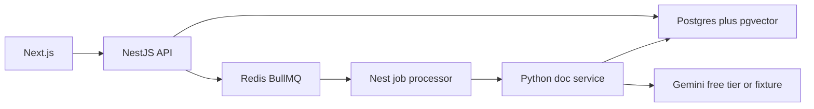

# AI-Powered Document Intelligence System

## Architecture

The system splits document work from the product API. Next.js is the review UI. NestJS owns uploads, job state, corrections, and search. A Python service reads files, calls the extractor, and validates totals. Redis is the queue. Postgres stores metadata, extracted JSON, and chunk vectors.

The BullMQ worker runs in the API process. A second API process can consume the same queue when more OCR throughput is needed. The upload request returns as soon as the job row is written.

## Why one database

pgvector keeps keyword filters and semantic search in Postgres. A separate vector database would add another service on an 8 GB machine. The embedding column is `vector(384)`, added beside the Prisma `chunks` table because Prisma does not model pgvector fields directly.

## Processing path

1. The API stores the file under `storage/uploads` using a generated name, then enqueues a job.
2. The worker marks the document `processing` and calls `POST /process`.
3. Python extracts digital PDF text with pypdf. A page with almost no text is rasterized and sent to Tesseract. Images and multi-page TIFFs take the same OCR path. Spreadsheets are read with openpyxl or xlrd, with `data_only=True` so formulas are values, not macros.
4. The extractor returns JSON. Missing values stay null.
5. Deterministic checks flag missing fields, bad dates or currency, line-sum mismatches, total mismatches, duplicate invoice number plus supplier, and cross-document total or line differences.
6. Clean documents become `completed`. Any issue becomes `needs_review`. Unreadable files become `failed` without stopping the worker.
7. Text chunks and a short field summary are embedded and stored for semantic search.

`DOC_PAGE_CAP` defaults to 50 so a long PDF cannot exhaust this laptop. Raise it when the worker has more memory. Pages are rasterized one at a time.

## Schema

| Table | Purpose |
| --- | --- |
| documents | File name, mime, storage path, sha256, status, page count, error |
| jobs | process or reprocess attempts, state, timestamps |
| document_texts | Page or sheet text |
| extractions | JSON result, provider, model, prompt version, current flag |
| line_items | Normalized description, quantity, unit price, amount |
| validation_issues | Code, field, message, severity |
| corrections | Field path, old value, new value |
| chunks | Text plus a 384-dimension vector |

Statuses are `queued`, `processing`, `needs_review`, `completed`, and `failed`.

Manual edits append a correction, store a new current extraction with provider `manual`, and run validation again. Reprocess enqueues a new job and replaces text, line items, issues, and chunks. Older extractions stay as history.

## Security choices

Uploads are limited to the seven document extensions and 25 MB. Stored names are generated, so the original file name is only a label. The Python service refuses paths outside `STORAGE_DIR`. Queries go through Prisma or parameterized SQL. The Gemini key stays in `.env`. There is no login in this version; put the API behind the company network or add an auth gateway before production.
